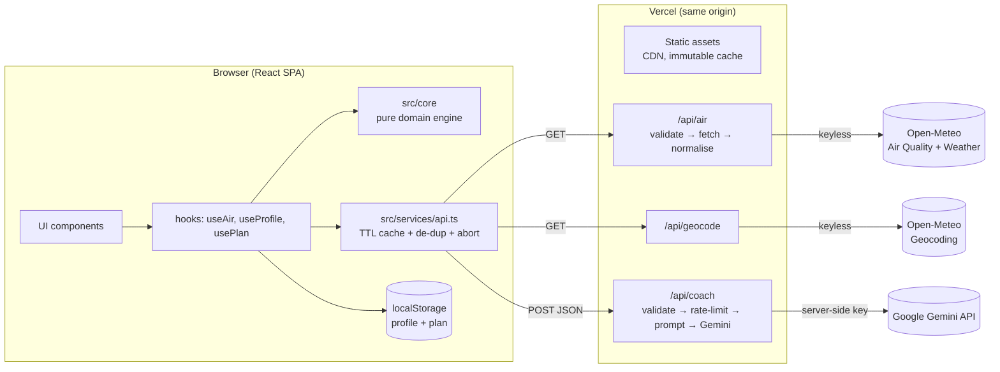

# Saans — Architecture & Development Framework

## 1. System overview



The browser only ever talks to its own origin. Third-party calls happen in
serverless functions, which lets us keep the API key secret, normalise data,
cache at the edge and lock the Content-Security-Policy to `'self'`.

## 2. Layers

| Layer          | Path              | Responsibility                                                                                         | Depends on               |
| -------------- | ----------------- | ------------------------------------------------------------------------------------------------------ | ------------------------ |
| Domain engine  | `src/core/`       | AQI, exposure, indoor model, emissions, clean windows, optimizer, explanations. Pure functions, no I/O | nothing                  |
| Services       | `src/services/`   | HTTP client with caching and abort, storage with schema checks                                         | core types               |
| Hooks          | `src/hooks/`      | React state orchestration, memoization                                                                 | core, services           |
| Components     | `src/components/` | Accessible presentation                                                                                | hooks, core (formatters) |
| Serverless API | `api/`            | Edge of the system: validation, rate limits, upstream calls, prompt building                           | `api/_lib` only          |

Rules: `core` never imports React or `fetch`; components never call `fetch`
directly; API handlers never trust client input; the coach contract is defined once in
`shared/coachContract.ts` and never duplicated.

Components are grouped by panel (`components/budget`, `components/home`,
`components/coach`) so each file has one job; panels only compose them. Stateful logic lives
in hooks (`useAir`, `usePlan`, `useCoach`, `useInsights`). Every panel is wrapped in an
`ErrorBoundary`, and every component has its own colocated test file.

## 3. Domain engine (`src/core`)

| Module         | Key functions                                                                                          |
| -------------- | ------------------------------------------------------------------------------------------------------ |
| `aqi.ts`       | `subIndex(pollutant, value)`, `computeAqi(reading)` → CPCB AQI, category, dominant pollutant           |
| `exposure.ts`  | `activityConcentration`, `activityDose`, `dayBudget` → dose per activity, totals, cigarette-equivalent |
| `indoor.ts`    | `indoorConcentration(room, outdoor)`, `rankHomeHacks(room, outdoor)`                                   |
| `emissions.ts` | `tripEmissions(mode, km)`, `weeklySwapImpact(swaps, frequencies)`, `communityScale`                    |
| `forecast.ts`  | `findCleanWindows(hourly)`, `bestHour(hourly, range)`                                                  |
| `optimizer.ts` | `suggestSwaps(plan, air, profile)`, `applySwap(plan, swap)`                                            |
| `explain.ts`   | Deterministic plain-language explanations; also the offline fallback for the AI coach                  |
| `constants.ts` | Every numeric assumption, documented in one place                                                      |

### Exposure model

```
dose_i (µg) = C_micro,i (µg/m³) × V̇_effort,i (m³/h) × t_i (h) × mask_i
C_micro     = C_outdoor(hours of activity) × f_setting      (outdoor / transit)
            = indoorConcentration(home, C_outdoor)          (home)
```

### Indoor model (single zone, steady state)

```
C_in = (P · a · C_out + S / V) / (a + k + CADR / V)
P = penetration, a = air changes per hour, k = deposition rate,
S = indoor source µg/h, V = room volume m³, CADR = clean air delivery rate m³/h
```

## 4. API contracts

### `GET /api/air?lat={-90..90}&lon={-180..180}`

Returns `{ location, current, hourly[24..48], fetchedAt }` with all concentrations in µg/m³.
`Cache-Control: public, s-maxage=900, stale-while-revalidate=1800`.

### `GET /api/geocode?q={2..60 chars}`

Returns up to 5 `{ name, admin, country, lat, lon }`. Cached for a day at the edge.

### `POST /api/coach`

```jsonc
{ "mode": "plan" | "ask" | "community",
  "language": "en" | "hi",
  "question": "string ≤ 500 chars (ask only)",
  "context": { /* bounded numeric summary computed by src/core */ } }
```

Returns `{ source: "gemini", result: {...} }` or `503 { error, fallback: true }`; the
client then renders the deterministic explanation.

## 5. Security model

| Threat                    | Control                                                                                                                             |
| ------------------------- | ----------------------------------------------------------------------------------------------------------------------------------- |
| API key leakage           | Key read only in `api/_lib/gemini.ts` from `process.env`; never bundled (no `VITE_` prefix)                                         |
| Malformed / hostile input | zod schemas with numeric bounds, string length caps, enum whitelists; 16 KB body limit                                              |
| Prompt injection          | User text fenced in delimiters, system instruction forbids following embedded instructions, JSON-schema output, output re-validated |
| XSS                       | React escaping; model output rendered as text only; strict CSP `default-src 'self'`                                                 |
| Abuse / cost              | Per-IP token-bucket rate limit on `/api/coach`, upstream timeouts via `AbortController`                                             |
| Clickjacking / sniffing   | `frame-ancestors 'none'`, `X-Frame-Options: DENY`, `nosniff`, `Referrer-Policy`, `Permissions-Policy` (geolocation=self only), HSTS |
| Privacy                   | Profile and plan live in `localStorage` only; coarse location (2 decimals) sent upstream                                            |

## 6. Efficiency

- Edge caching of air (15 min) and geocoding (24 h) responses.
- Client cache with TTL + in-flight request de-duplication + `AbortController` on
  location change.
- `useMemo` around every model computation; optimizer runs only when inputs change.
- AI panel is code-split with `React.lazy`.
- No UI or chart libraries; SVG drawn by hand; system font stack.
- Coach responses memoised by a hash of the request on the client.

## 7. Development framework

| Concern       | Tooling                                                               |
| ------------- | --------------------------------------------------------------------- |
| Language      | TypeScript (strict)                                                   |
| UI            | React 19 + Vite                                                       |
| Serverless    | Vercel Functions (Node.js runtime, Web-standard `Request`/`Response`) |
| Validation    | zod                                                                   |
| Tests         | Vitest, @testing-library/react, jsdom, axe-core                       |
| Lint / format | ESLint (typescript-eslint, react-hooks, jsx-a11y), Prettier           |
| CI            | GitHub Actions: lint → typecheck → test (coverage) → build            |
| Deploy        | `vercel --prod` (Vite preset auto-detected; headers in `vercel.json`) |

### Phases

1. **Phase 0** — solution + architecture docs, scaffold, tooling.
2. **Phase 1** — domain engine with unit tests.
3. **Phase 2** — serverless API with tests.
4. **Phase 3** — accessible UI and component tests.
5. **Phase 4** — hardening, accessibility audit, deploy, README.

Each phase is committed and pushed separately.
